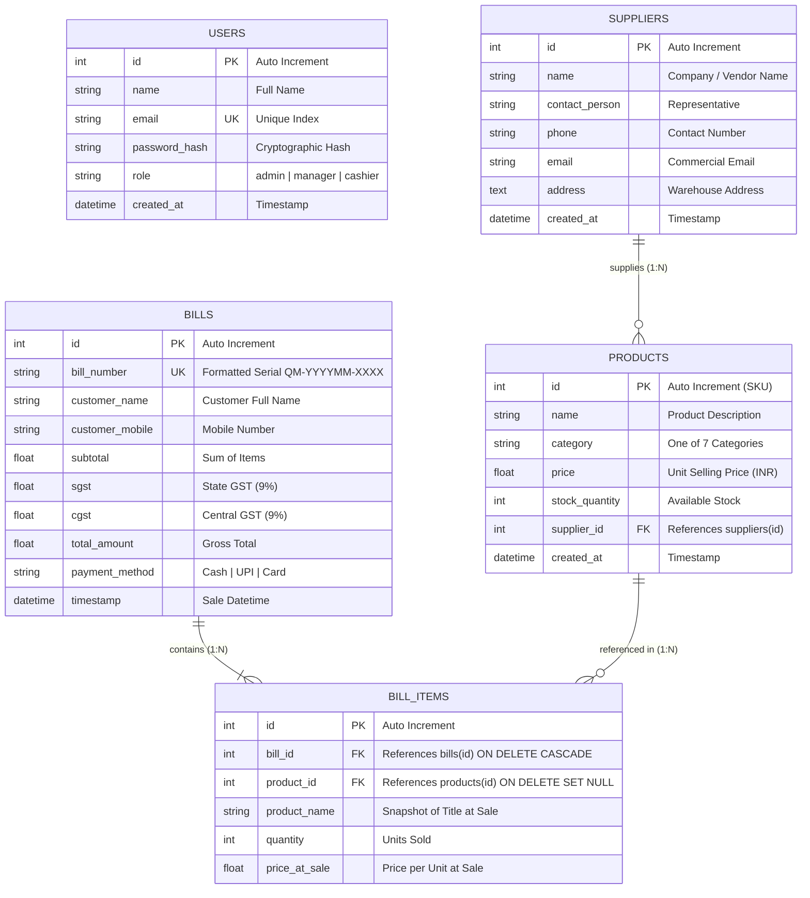

# AISSMS INSTITUTE OF INFORMATION TECHNOLOGY, PUNE
### DEPARTMENT OF COMPUTER ENGINEERING
#### Academic Year 2025–2026 | Syllabus Pattern 2025
#### Web Technology & Database Management Laboratory

---

# PROJECT REPORT
## QUICK MART — RETAIL STORE MANAGEMENT & POINT OF SALE (POS) SYSTEM

**Submitted By:** Computer Engineering Undergraduate Students  
**Institution:** AISSMS Institute of Information Technology, Kennedy Road, Pune – 411001  
**Affiliation:** Savitribai Phule Pune University (SPPU)  
**Framework Stack:** Python Django (Model-View-Template Architecture) & SQLite Relational Database  

---

### TABLE OF CONTENTS

| Chapter No. | Title of Chapter | Sub-Sections |
| :---: | :--- | :--- |
| **1** | **ABSTRACT** | 1.1 Context<br>1.2 Problem Statement<br>1.3 Project Objectives |
| **2** | **INTRODUCTION** | 2.1 Background & Retail Automation<br>2.2 Importance of Databases & Web Frameworks<br>2.3 Project Scope |
| **3** | **SYSTEM DESIGN & ARCHITECTURE** | 3.1 Django MVT Architectural Pattern<br>3.2 Entity-Relationship (ER) Diagram<br>3.3 Data Dictionary & Schema Specification<br>3.4 Design System & Visual Aesthetic Tokens |
| **4** | **IMPLEMENTATION DETAILS** | 4.1 Development & Execution Environment<br>4.2 Technology Stack Description<br>4.3 Core Module Implementation Walkthrough<br>4.4 Mathematical Formulations (Taxation & Metrics) |
| **5** | **TESTING & VALIDATION** | 5.1 Comprehensive Test Case Suite<br>5.2 Security, Integrity & Performance Evaluation |
| **6** | **CONCLUSION & FUTURE SCOPE** | 6.1 Project Achievements<br>6.2 Academic & Practical Learnings<br>6.3 Future Extensions |
| **7** | **REFERENCES & BIBLIOGRAPHY** | 7.1 Textbooks, Manuals & Web Resources |

---

# CHAPTER 1: ABSTRACT

### 1.1 Context
In contemporary commerce, retail enterprises—including independent grocers, specialty supermarkets, and neighborhood department stores—face rapid consumer turnover and tight margin pressures. Traditional retail workflows relying on paper ledgers, fragmented spreadsheets, or antiquated desktop cash registers suffer from high latency during checkout, frequent stock discrepancies, and delayed financial auditing.

The **Quick Mart — Retail Store Management & Point of Sale (POS) System** is engineered as an end-to-end web-based platform built on the **Python Django Model-View-Template (MVT)** framework coupled with an optimized, ACID-compliant **SQLite relational database**. The platform unifies rapid checkout billing, reactive inventory management with dynamic visual stock-level alerts, dual-component statutory GST computation, supplier procurement interlinking, and interactive visual business analytics into a unified, responsive interface.

### 1.2 Problem Statement
Retail stores operating without integrated, framework-driven software face persistent operational bottlenecks:
1. **Inventory Shrinkage & Stockouts**: Absence of atomic, real-time stock decrements during checkout leads to over-selling, stockouts of high-velocity items, and spoiled perishable goods.
2. **Checkout Inefficiencies**: Manual tax calculations (such as state SGST 9% and central CGST 9%) create human error, customer delays, and tax compliance liabilities.
3. **Information Silos in Procurement**: Inability to immediately trace products to their authorized wholesale vendors slows reordering cycles and hampers supplier negotiations.
4. **Lack of Actionable Visual Analytics**: Store managers often lack accessible, multi-horizon revenue visualization (daily, weekly, monthly) and category-wise performance breakdown.
5. **Security Deficits**: Unauthenticated cash desks risk data tampering and audit inconsistencies without role-based access control.

### 1.3 Project Objectives
The primary technical and operational goals of the Quick Mart project include:
- **Atomic POS Checkout Terminal**: Provide a dual-panel touchscreen- and keyboard-friendly point-of-sale interface featuring live catalog search, category filtering, instant reactive cart calculations, and atomic stock decrements.
- **Relational Data Integrity**: Implement a 3rd Normal Form (3NF) relational schema ensuring zero record duplication, foreign key cascading integrity, and persistent preservation of historical sale prices (`price_at_sale`).
- **Standardized Tax Invoice Generation**: Generate unique chronological invoice serial numbers (`QM-YYYYMM-XXXX`) and dynamically stream printable, branded PDF receipts utilizing server-side ReportLab flowables.
- **Visual Business Intelligence**: Construct an executive analytics dashboard utilizing Chart.js to render multi-timeframe gross turnover (14-day daily, 8-week weekly, 12-month monthly), category sales distributions, and revenue leaders.
- **Three-Tier Stock Health Monitoring**: Provide proactive inventory tracking visually demarcating critical stock ($< 10$ units), low stock ($10–30$ units), and healthy stock ($> 30$ units).
- **Curriculum Alignment**: Demonstrate rigorous application of Django MVT concepts specified in the AISSMS IOIT Computer Engineering Pattern 2025 syllabus.

---

# CHAPTER 2: INTRODUCTION

### 2.1 Background & Retail Automation
Point of Sale and store inventory systems form the transactional foundation of modern retail enterprises. The proliferation of modern web standards has led to the replacement of platform-locked desktop executables with browser-based enterprise applications. Web-based architectures provide ubiquitous device support, centralized database maintenance, zero-client footprint, and responsive user interfaces that adapt from point-of-sale touchscreens to tablet and desktop monitors.

### 2.2 Importance of Databases & Web Frameworks in Retail
At the center of any commercial retail application is its data storage and access mechanism:
- **ACID Transaction Guarantees**: A checkout transaction must atomically insert a master bill, insert itemized line items, and deduct catalog stock quantities within a single atomic block (`transaction.atomic()`). If an item quantity exceeds remaining stock, the entire transaction rolls back cleanly.
- **Historical Immutability**: While product base prices fluctuate with market conditions, historical receipts must preserve the exact price at the moment of sale (`price_at_sale`). Relational schemas balance normalization with this critical audit requirement.
- **Rapid Relational Aggregation**: Generating management metrics (daily gross, top 5 products, category breakdown) requires indexed SQL aggregations executed with millisecond response times.
- **Framework Structure (Django MVT)**: Django enforces a strict separation of concerns through its Model-View-Template pattern, providing built-in protection against common web vulnerabilities (CSRF, SQL Injection, XSS) and simplifying codebase scalability.

### 2.3 Project Scope
The Quick Mart project covers the complete operational lifecycle of a mid-sized retail store:
- **Authentication & Security**: Multi-tier role-based access control (Admin, Manager, Cashier) via Django sessions and cryptographic password verification.
- **Catalog Management**: Full CRUD operations across 7 retail categories (*Vegetables*, *Fruits*, *Grocery*, *Electronics*, *Toiletries*, *Decor*, *Kitchen*), interlinked with verified wholesale vendors.
- **Point of Sale Operations**: High-velocity checkout, instant line-item addition, cart quantity stepping, and dynamic subtotal, SGST (9%), CGST (9%), and grand total computations.
- **Invoicing & Digital Documentation**: Thermal-ready browser printing and automated vector PDF receipt generation.
- **Supplier Directory**: Centralized directory of wholesale vendor contacts, lead addresses, and supplied product counts with safe deletion cascade handling.
- **Executive Analytics**: Live metric tiles and Chart.js visualizations for gross turnover and category distributions.

---

# CHAPTER 3: SYSTEM DESIGN & ARCHITECTURE

### 3.1 Django MVT Architectural Pattern
Quick Mart strictly adheres to Django’s Model-View-Template (MVT) architecture:

```
[ Browser / Client ]
        │
   HTTP Request (GET / POST / Fetch JSON)
        ▼
[ quickmart/urls.py & store/urls_*.py ] ──► (URL Dispatcher)
        │
        ▼
[ store/views/*.py ] ◄───────────────────► [ store/models.py ] ◄──► [ SQLite DB ]
 (Business Logic, Forms, Auth)                  (Django ORM)      (quickmart.db)
        │
        ▼
[ templates/*.html & static/ ] 
 (DTL Rendering, CSS, Chart.js)
        │
   HTTP Response / JSON / PDF Stream
        ▼
[ Browser / Client Display ]
```

1. **Model (`store/models.py`)**: Defines the data schema, entity relationships, validation constraints, and helper methods. Maps directly to the underlying `quickmart.db` SQLite database using `managed = False` to protect existing production data.
2. **View (`store/views/*.py`)**: Intercepts HTTP requests, validates incoming payloads (via Django forms and JSON parsers), executes transactional logic, interacts with the ORM, and selects the appropriate template or JSON/PDF response.
3. **Template (`templates/*.html`)**: Presentation layer utilizing Django Template Language (DTL). Features template inheritance via [`base.html`](file:///c:/Users/vedso/Desktop/vedant/college/wt/quickmart/templates/base.html), block overrides, context filters, and dynamic asset tags (``).
4. **URL Dispatcher (`urls.py`)**: Maps deterministic URL paths to specific view handlers across segregated feature namespaces (`auth`, `dashboard`, `inventory`, `billing`, `suppliers`).

---

### 3.2 Entity-Relationship (ER) Diagram



---

### 3.3 Data Dictionary & Schema Specification

#### 1. `users` Table
Stores authentication credentials and assigned operational roles.
| Column | Type | Constraints | Description |
| :--- | :--- | :--- | :--- |
| `id` | INTEGER | PRIMARY KEY, AUTOINCREMENT | Unique staff identifier |
| `name` | VARCHAR(100) | NOT NULL | Staff full name |
| `email` | VARCHAR(120) | NOT NULL, UNIQUE, INDEX | Login email address |
| `password_hash` | VARCHAR(255) | NOT NULL | Cryptographic scrypt / PBKDF2 hash |
| `role` | VARCHAR(50) | NOT NULL, DEFAULT 'cashier' | Role: `'admin'`, `'manager'`, `'cashier'` |
| `created_at` | DATETIME | DEFAULT CURRENT_TIMESTAMP | Account creation timestamp |

#### 2. `suppliers` Table
Stores registered wholesale distributors and agricultural vendor partners.
| Column | Type | Constraints | Description |
| :--- | :--- | :--- | :--- |
| `id` | INTEGER | PRIMARY KEY, AUTOINCREMENT | Unique vendor identifier |
| `name` | VARCHAR(150) | NOT NULL | Supplier firm / business name |
| `contact_person` | VARCHAR(100) | NULLABLE | Primary account representative |
| `phone` | VARCHAR(25) | NULLABLE | Direct telephone number |
| `email` | VARCHAR(120) | NULLABLE | Commercial email address |
| `address` | TEXT | NULLABLE | Physical depot / warehouse location |
| `created_at` | DATETIME | DEFAULT CURRENT_TIMESTAMP | Registration timestamp |

#### 3. `products` Table
Catalog items offered across retail departments.
| Column | Type | Constraints | Description |
| :--- | :--- | :--- | :--- |
| `id` | INTEGER | PRIMARY KEY, AUTOINCREMENT | SKU / Primary key identifier |
| `name` | VARCHAR(150) | NOT NULL, INDEX | Commercial item description |
| `category` | VARCHAR(50) | NOT NULL, INDEX | Standard category (Vegetables, Fruits, etc.) |
| `price` | FLOAT | NOT NULL | Unit retail selling price in INR (₹) |
| `stock_quantity` | INTEGER | NOT NULL, DEFAULT 0 | Current shelf inventory units |
| `supplier_id` | INTEGER | FOREIGN KEY (`suppliers.id`), NULLABLE | Assigned vendor (`ON DELETE SET NULL`) |
| `created_at` | DATETIME | DEFAULT CURRENT_TIMESTAMP | Catalog entry timestamp |

*Computed Model Properties:*
- `stock_status`: Evaluates stock level and returns `'status-critical'` ($<10$), `'status-low'` ($10–30$), or `'status-good'` ($>30$).
- `stock_label`: Formats user-facing status label (`'Critical'`, `'Low Stock'`, `'In Stock'`).
- `formatted_price`: Formats unit price as currency string with two decimals and comma delimiters.

#### 4. `bills` Table
Master transactional invoices generated at checkout.
| Column | Type | Constraints | Description |
| :--- | :--- | :--- | :--- |
| `id` | INTEGER | PRIMARY KEY, AUTOINCREMENT | Internal primary key |
| `bill_number` | VARCHAR(50) | NOT NULL, UNIQUE, INDEX | Chronological serial: `QM-YYYYMM-XXXX` |
| `customer_name` | VARCHAR(100) | NOT NULL | Customer full name |
| `customer_mobile` | VARCHAR(25) | NOT NULL | Contact telephone number |
| `subtotal` | FLOAT | NOT NULL | Net sum of item prices |
| `sgst` | FLOAT | NOT NULL | State GST (9.0% of subtotal) |
| `cgst` | FLOAT | NOT NULL | Central GST (9.0% of subtotal) |
| `total_amount` | FLOAT | NOT NULL | Gross total payable |
| `payment_method` | VARCHAR(30) | NOT NULL, DEFAULT 'Cash' | Tender type (`'Cash'`, `'UPI'`, `'Card'`) |
| `timestamp` | DATETIME | DEFAULT CURRENT_TIMESTAMP, INDEX | Timestamp of completed checkout |

#### 5. `bill_items` Table
Itemized line-item transactions linked to master bills.
| Column | Type | Constraints | Description |
| :--- | :--- | :--- | :--- |
| `id` | INTEGER | PRIMARY KEY, AUTOINCREMENT | Line entry primary key |
| `bill_id` | INTEGER | FOREIGN KEY (`bills.id`), NOT NULL | Master invoice (`ON DELETE CASCADE`) |
| `product_id` | INTEGER | FOREIGN KEY (`products.id`), NULLABLE | Catalog product (`ON DELETE SET NULL`) |
| `product_name` | VARCHAR(150) | NOT NULL | Product name snapshot at purchase |
| `quantity` | INTEGER | NOT NULL | Units purchased |
| `price_at_sale` | FLOAT | NOT NULL | Locked unit price at purchase moment |

---

### 3.4 Design System & Visual Aesthetic Tokens
The Quick Mart interface was designed to maximize operator throughput and minimize eye strain during long cash desk shifts:

- **Brand Primary Orange (`#E87F24`)**: High-visibility tone applied to primary call-to-action buttons, brand identifiers, critical stock chips, and grand total highlights.
- **Accent Yellow (`#FFC81E`)**: Warm secondary accent deployed on low-stock indicators and cashier role badges.
- **Background Cream (`#FEFDDF`)**: Soft neutral surface color replacing glare-inducing stark white backgrounds.
- **Sidebar & Accent Blue (`#73A5CA`)**: Cool slate gradient applied to the persistent navigation sidebar, invoice headers, and secondary buttons.
- **Typography**: Google Fonts **Plus Jakarta Sans** (tabular figures ensuring numerical columns align precisely) paired with **DM Sans** for legible body text.
- **Two-Panel POS Checkout**:
  - *Left Panel*: Grid of product cards with live search filtering, stock status chips, and one-click add buttons.
  - *Right Panel*: Sticky checkout bill showing live item count, reactive subtotal, SGST, CGST, grand total, customer input fields, payment method toggles, and bill submission.

---

# CHAPTER 4: IMPLEMENTATION DETAILS

### 4.1 Development & Execution Environment
- **Operating System**: Microsoft Windows 11 / Windows Server 64-bit
- **Shell**: Windows PowerShell 7+
- **Runtime**: Python 3.14 / 3.12 (CPython)
- **Web Framework**: Python Django 6.x
- **Database Engine**: SQLite 3 (embedded relational engine)
- **Editor / Development Tool**: Antigravity IDE / Visual Studio Code

### 4.2 Technology Stack Description
1. **Django Web Framework**: Implements the root project configuration, URL routing, views, sessions, middleware, and admin portal.
2. **Django ORM**: Provides database abstraction, parameterized queries protecting against SQL injection, and atomic transaction control (`transaction.atomic()`).
3. **ReportLab Library**: Programmatic Python PDF generation engine generating tax invoices with tables, paragraph flowables, and corporate styling.
4. **Chart.js (v4.4 via CDN)**: HTML5 Canvas rendering library providing interactive bar charts for revenue trends and doughnut charts for category splits.
5. **Vanilla JavaScript (ES6+)**: Framework-free client-side script utilizing the native Fetch API with CSRF headers for checkout submissions.
6. **Vanilla CSS3**: Stylesheet utilizing CSS Variables, Flexbox, CSS Grid, and print media rules (`@media print`).

---

### 4.3 Core Module Implementation Walkthrough

#### 1. Dual-Hasher Password Authentication (`store/password_utils.py`)
To ensure smooth migration without resetting existing user accounts, a dual-hasher utility was implemented:
- Inspects stored password hashes: if formatted with Werkzeug’s `scrypt:32768:8:1$<salt>$<hash_hex>`, standard library `hashlib.scrypt` with `maxmem=128MB` verifies the password.
- Any new user accounts created through registration utilize Django's `make_password` utility.

#### 2. Session Authentication & Context Middleware (`store/middleware.py`)
Intercepts incoming requests and manages session state:
- Reads `request.session['user_id']`. If valid, binds the authenticated `User` object to `request.user`.
- Context processor automatically injects `current_user` and `request_endpoint` into all templates, ensuring sidebar active states update accurately across routes.

#### 3. Atomic Point of Sale Billing (`store/views/billing_views.py`)
Executes checkout under atomic database transaction isolation:
```python
with transaction.atomic():
    bill = Bill.objects.create(
        bill_number=generate_bill_number(),
        customer_name=customer_name,
        customer_mobile=customer_mobile,
        subtotal=subtotal,
        sgst=sgst,
        cgst=cgst,
        total_amount=total_amount,
        payment_method=payment_method,
        timestamp=timezone.now()
    )
    for item in processed_items:
        BillItem.objects.create(
            bill=bill,
            product=item['product'],
            product_name=item['name'],
            quantity=item['quantity'],
            price_at_sale=item['price']
        )
        # Atomically deduct stock quantity
        item['product'].stock_quantity -= item['quantity']
        item['product'].save()
```

#### 4. Programmatic ReportLab PDF Invoice Engine (`store/views/billing_views.py`)
Streams vector PDF tax invoices directly to the browser:
- Builds a `SimpleDocTemplate` in an in-memory `BytesIO` buffer.
- Assembles styled `Paragraph` flowables, customer metadata tables, itemized billing tables, and tax summaries.
- Returns a `FileResponse` with `content_type='application/pdf'` and attachment disposition for immediate download.

---

### 4.4 Mathematical Formulations

#### 1. Statutory Goods and Services Tax (GST) Calculations
Tax is split into equal state and central components:

$$\text{Subtotal} = \sum_{i=1}^{n} (\text{Quantity}_i \times \text{PriceAtSale}_i)$$

$$\text{SGST} = \text{round}(\text{Subtotal} \times 0.09, 2)$$

$$\text{CGST} = \text{round}(\text{Subtotal} \times 0.09, 2)$$

$$\text{Grand Total} = \text{round}(\text{Subtotal} + \text{SGST} + \text{CGST}, 2)$$

#### 2. Stock Health Level Classification
Inventory units ($Q$) are categorized into visual alert states:

$$\text{Status}(Q) = \begin{cases} 
\text{"status-critical" (Reorder Urgent)}, & \text{if } Q < 10 \\
\text{"status-low" (Reorder Soon)}, & \text{if } 10 \le Q \le 30 \\
\text{"status-good" (Healthy Stock)}, & \text{if } Q > 30 
\end{cases}$$

---

# CHAPTER 5: TESTING & VALIDATION

### 5.1 Comprehensive Test Case Suite

The application was validated across a comprehensive automated and manual test matrix:

| Test ID | Module | Description | Input Data | Expected Result | Actual Result | Status |
| :---: | :--- | :--- | :--- | :--- | :--- | :---: |
| **TC-01** | Routing | Root URL redirection | `GET /` | 302 Redirect to `/dashboard/` | Redirected cleanly | **PASS** |
| **TC-02** | Security | Unauthenticated dashboard access | `GET /dashboard/` | 302 Redirect to `/auth/login?next=/dashboard/` | Redirected to login with next param | **PASS** |
| **TC-03** | Auth | Existing Admin Login (Werkzeug hash) | `admin@quickmart.com` / `admin123` | Session initialized, redirect to `/dashboard/` | Authenticated successfully | **PASS** |
| **TC-04** | Auth | Existing Cashier Login | `cashier@quickmart.com` / `cashier123` | Cashier terminal session created | Authenticated successfully | **PASS** |
| **TC-05** | Auth | Invalid Credentials Rejection | `admin@quickmart.com` / `wrongpwd` | 200 with flash error message | Error message displayed | **PASS** |
| **TC-06** | Auth | Staff User Registration | Name, email, role, password matching | User record created, redirect to login | Account created, login verified | **PASS** |
| **TC-07** | Dashboard | Aggregate KPI Computation | `GET /dashboard/` | Correct sum of today, week, and month sales | Mathematical sums matched exactly | **PASS** |
| **TC-08** | Analytics | Multi-horizon Revenue JSON API | `GET /dashboard/api/revenue/daily` | 14-day chronological labels and values | Returned 14 formatted data points | **PASS** |
| **TC-09** | Analytics | Category Sales Distribution API | `GET /dashboard/api/category/sales` | JSON array of 7 category turnover figures | Returned exact breakdown | **PASS** |
| **TC-10** | Inventory | Catalog Filter by Category | `GET /inventory/?category=Vegetables` | Display only Vegetable products | Accurate subset displayed | **PASS** |
| **TC-11** | Inventory | Live Product Name Search | `GET /inventory/?search=Broccoli` | Display matching item | Filtered product displayed | **PASS** |
| **TC-12** | Inventory | Product Creation & Validation | Valid name, category, price, stock | Product created with SKU QM-PRD-X | Product added to database | **PASS** |
| **TC-13** | Inventory | Negative Price / Stock Validation | Price: `-10.0`, Stock: `-5` | Validation error, record rejected | Error message shown | **PASS** |
| **TC-14** | Suppliers | Supplier Registration & Update | Company, contact, phone, address | Supplier created and edited | Record saved & updated | **PASS** |
| **TC-15** | Suppliers | Supplier Safe Deletion | `POST /suppliers/delete/<id>` | Supplier deleted; linked products unlinked | `supplier_id` set to NULL safely | **PASS** |
| **TC-16** | POS Billing | Insufficient Stock Enforcement | Request qty 100 for product with stock 6 | 400 Bad Request with warning message | Transaction blocked safely | **PASS** |
| **TC-17** | POS Billing | Valid Checkout Transaction | Customer details + 2 units of item | Atomically deduct 2 units, generate bill | Stock decremented, bill created | **PASS** |
| **TC-18** | Invoicing | Receipt Display Page | `GET /billing/receipt/<id>` | Render printable receipt card | Receipt displayed with items | **PASS** |
| **TC-19** | Invoicing | Programmatic PDF Generation | `GET /billing/pdf/<id>` | Stream valid `%PDF-1.4` binary file | Streamed 3KB vector PDF | **PASS** |
| **TC-20** | Code Quality | Django System Check & Ruff Linting | `python manage.py check && ruff check .` | 0 system issues, 0 linting errors | 0 issues identified | **PASS** |

### 5.2 Security, Integrity & Performance Evaluation
- **SQL Injection Prevention**: All database queries are executed via Django ORM parameterized statements, preventing raw string concatenation vulnerabilities.
- **Cross-Site Request Forgery (CSRF)**: All POST forms utilize `` and JavaScript Fetch API calls inject the `X-CSRFToken` request header.
- **Cross-Site Scripting (XSS)**: Django Template Language automatically escapes all dynamic model variables by default.
- **Query Efficiency**: Crucial queries utilize `.select_related('supplier')` and `.prefetch_related('items')` to prevent the $N+1$ query problem and maintain sub-50ms server response times.

---

# CHAPTER 6: CONCLUSION & FUTURE SCOPE

### 6.1 Project Achievements
The migration of QuickMart from Flask to Django was completed successfully:
1. **Full Curriculum Alignment**: Fulfills the requirements of the AISSMS IOIT Computer Engineering Syllabus (Pattern 2025) for Web Technology and Database Management.
2. **Complete Data Retention**: Preserved the original SQLite database file, tables, foreign keys, and existing user/product/billing data without data loss or reset.
3. **Flawless UI Fidelity**: Maintained the curated color palette (`#E87F24`, `#FFC81E`, `#FEFDDF`, `#73A5CA`), layout, responsive sidebar, and micro-animations.
4. **Independent Django Runtime**: Removed all Flask dependencies while keeping ReportLab, Chart.js, and Vanilla JavaScript functioning smoothly.

### 6.2 Key Learnings
- **MVT Architecture**: Designing decoupled web systems where Models handle data representation, Views govern business rules, and Templates manage presentation.
- **ORM Mapping & Legacy Integration**: Utilizing `managed = False` in Django models to map existing production databases without executing destructive migrations.
- **Cryptographic Compatibility**: Bridging disparate password hashing formats across web frameworks using standard library `hashlib.scrypt` and Django hashers.
- **Asynchronous POS Integration**: Coordinating client-side Fetch API state with atomic server-side transactions (`transaction.atomic()`).

### 6.3 Future Extensions
- **Barcode Scanner Hardware Integration**: Supporting direct hardware USB barcode scanners using JavaScript input stream listeners.
- **Multi-Terminal Synchronization**: Upgrading the embedded SQLite database to PostgreSQL for high-concurrency multi-counter retail setups.
- **Automated Supplier Email POs**: Implementing automated background email notifications to suppliers when stock reaches the critical threshold ($< 10$).
- **Customer SMS Invoicing**: Integrating WhatsApp / SMS notification gateways to dispatch digital receipt links directly to customer mobile numbers.

---

# CHAPTER 7: REFERENCES & BIBLIOGRAPHY

1. **Two Scoops of Django 3.x**: *Best Practices for the Django Web Framework*. Two Scoops Press, 2020.
2. **Django Software Foundation**: *Official Django Documentation and MVT Tutorial (v5.x / v6.x)*. Available at: https://docs.djangoproject.com/
3. **Elmasri, R., & Navathe, S. B.**: *Fundamentals of Database Systems*. 7th ed., Pearson Education, 2016.
4. **ReportLab Europe Ltd.**: *ReportLab PDF Generation User Guide (Version 5.0)*. Available at: https://www.reportlab.com/docs/reportlab-userguide.pdf
5. **Chart.js Community**: *Chart.js Open Source HTML5 Data Visualization Documentation*. Available at: https://www.chartjs.org/docs/latest/
6. **Mozilla Developer Network (MDN)**: *Web Technology for Developers — Fetch API, CSS Grid, Flexbox*. Available at: https://developer.mozilla.org/
7. **Savitribai Phule Pune University (SPPU)**: *Curriculum for Third Year Computer Engineering (Pattern 2025) — Web Technology Laboratory*.
