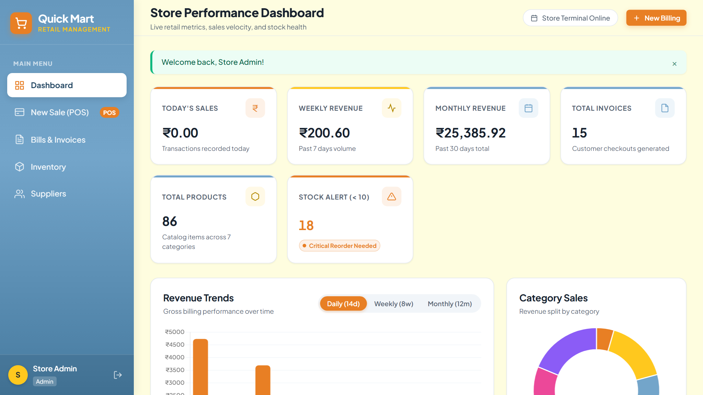
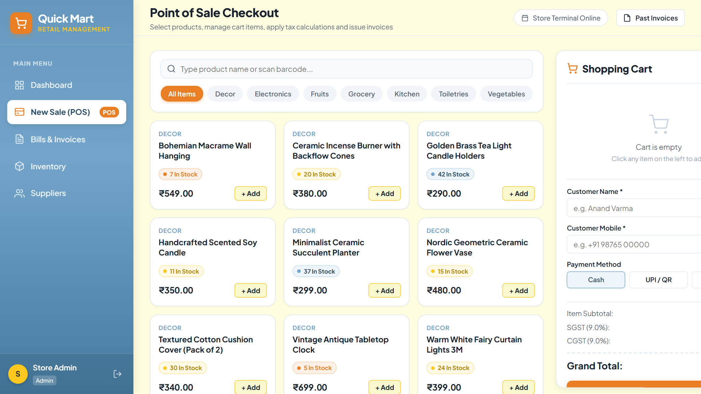
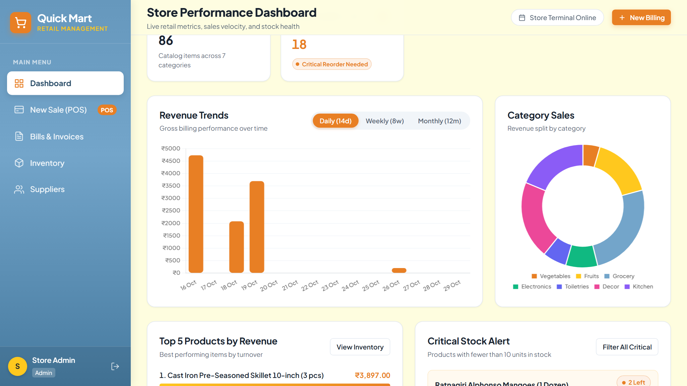
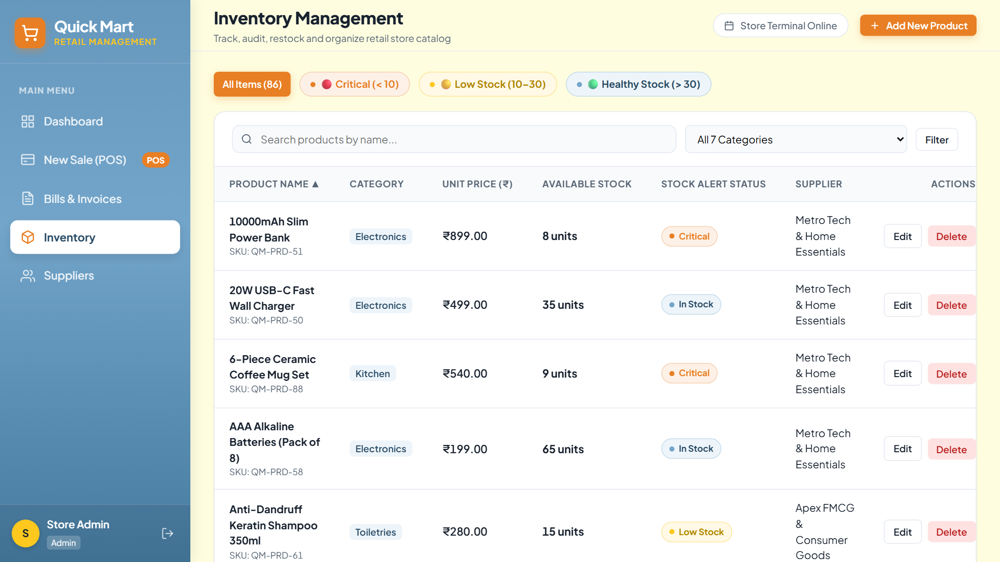
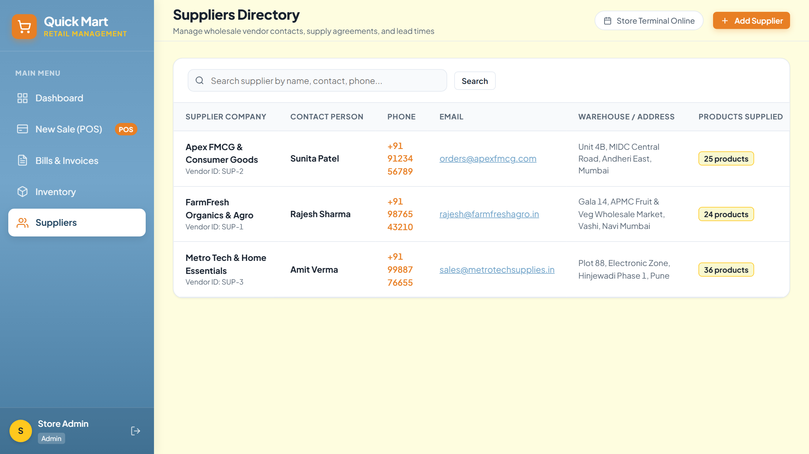
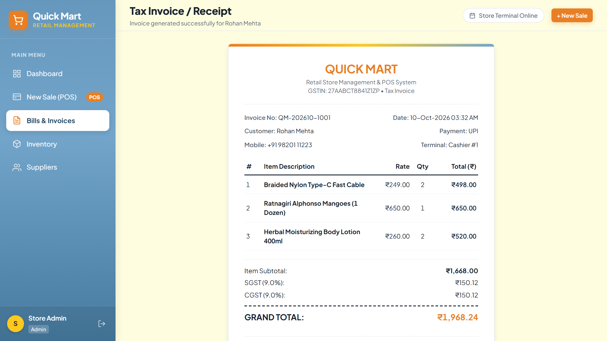
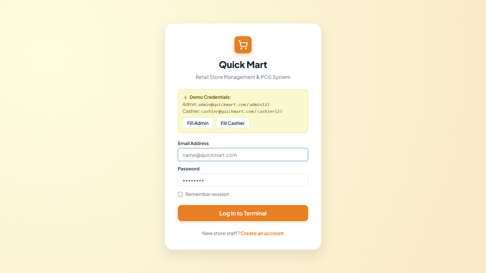
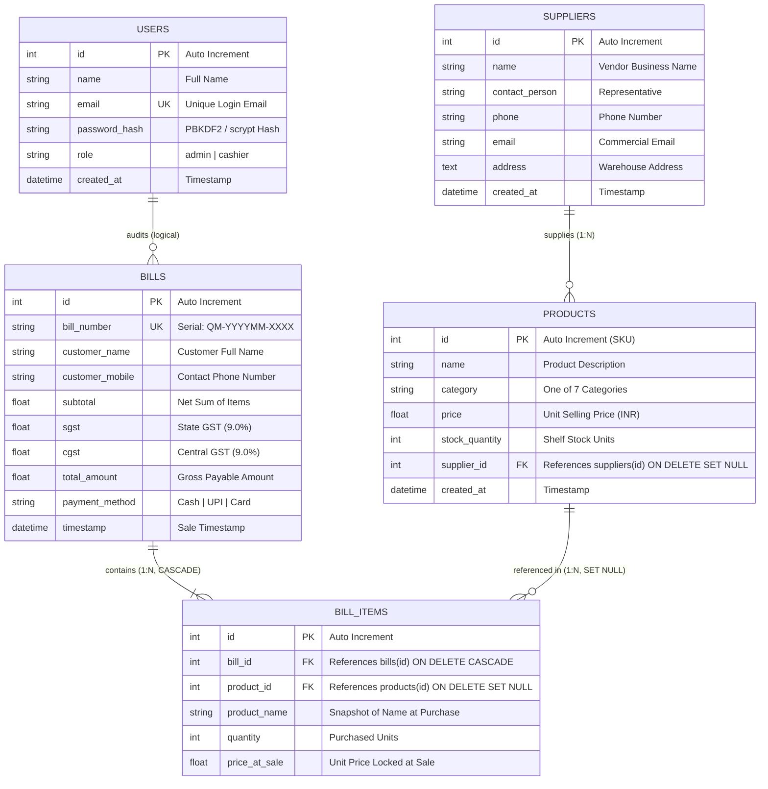

# Quick Mart — Retail Store Management & Point of Sale System

[](https://www.python.org/)
[](https://www.djangoproject.com/)
[](https://www.sqlite.org/)
[](https://www.chartjs.org/)
[](https://www.reportlab.com/)
[](LICENSE)

> **Quick Mart** is an end-to-end web-based Retail Store Management and Point of Sale (POS) system engineered with Python Django and an ACID-compliant relational SQLite database. Designed to modernize retail operations for independent grocers and supermarkets, the platform unifies high-velocity touchscreen POS checkout, atomic stock decrements, dual-component statutory GST computation (SGST 9% + CGST 9%), wholesale supplier tracking, and interactive Chart.js business analytics into a unified, responsive interface.

---

## 📑 Table of Contents
1. [Project Overview](#-project-overview)
2. [Key Features](#-key-features)
3. [Technology Stack](#-technology-stack)
4. [Application Screenshots](#-application-screenshots)
5. [System Architecture](#-system-architecture)
6. [Database Design & ER Diagram](#-database-design--er-diagram)
7. [Installation & Execution Guide](#-installation--execution-guide)
8. [User Roles & Permissions](#-user-roles--permissions)
9. [Business Intelligence & Analytics](#-business-intelligence--analytics)
10. [Project Directory Structure](#-project-directory-structure)
11. [Testing & Verification](#-testing--verification)
12. [Future Enhancements](#-future-enhancements)
13. [Project Author](#-project-author)

---

## 🌟 Project Overview

### Problem Statement
Traditional retail stores operating with paper ledgers, fragmented spreadsheets, or platform-locked desktop registers encounter significant operational friction:
* **Inventory Shrinkage & Stockouts**: Lack of atomic, real-time stock decrements during high-traffic checkout hours results in overselling and unexpected stockouts.
* **Billing Delays & Tax Inaccuracies**: Manual tax calculations (such as state SGST 9% and central CGST 9%) cause checkout queues, calculation errors, and tax compliance liabilities.
* **Information Silos in Procurement**: Inability to immediately link products with verified wholesale vendors slows down reordering cycles.
* **Lack of Accessible Analytics**: Store managers often lack multi-horizon visual analytics to track daily turnover, monitor category revenue distribution, or identify low-stock items before shelves are bare.

### How Quick Mart Solves This
Quick Mart replaces fragmented retail tools with an integrated web platform built on Django's Model-View-Template architecture:
* **High-Velocity POS Terminal**: A two-panel billing layout enabling live product filtering, instant cart calculations, payment method toggles, and atomic stock decrements.
* **Standardized Digital Invoicing**: Generates formatted invoice serials (`QM-YYYYMM-XXXX`), on-screen thermal print views, and dynamic server-side vector PDF invoices via ReportLab.
* **Proactive Inventory Monitoring**: Visual three-tier stock health indicators (Critical $<10$, Low $10–30$, Healthy $>30$) that alert store staff to urgent reordering requirements.
* **Executive Decision Intelligence**: Real-time KPI summaries and interactive Chart.js turnover trends (Daily, Weekly, Monthly) for data-driven store management.

---

## 🚀 Key Features

* **High-Speed Point of Sale Billing**: Dual-panel checkout screen with live search, category tabs, quantity steppers, and reactive totals.
* **Statutory Dual GST Calculation**: Automatically computes State GST (9.0%) and Central GST (9.0%) with sub-cent rounding precision.
* **Multi-Tender Payment Methods**: Supports **Cash**, **UPI**, and **Card** transactions.
* **Atomic Transaction Safety**: Utilizes Django's `transaction.atomic()` context manager to ensure invoice creation, line-item insertion, and stock deduction succeed together or roll back cleanly.
* **Server-Side Vector PDF Invoicing**: Programmatically generates and streams downloadable `%PDF-1.4` receipts using **ReportLab 5.0**.
* **Reactive Multi-Category Inventory**: Manages catalog items across 7 departments (*Vegetables*, *Fruits*, *Grocery*, *Electronics*, *Toiletries*, *Decor*, *Kitchen*) with full search, filter, and sorting.
* **Three-Tier Visual Stock Health Indicators**:
  * 🔴 **Critical Stock** ($< 10$ units) — Urgent replenishment alert
  * 🟡 **Low Stock** ($10–30$ units) — Reorder notification
  * 🟢 **In Stock** ($> 30$ units) — Healthy inventory level
* **Wholesale Supplier Directory**: Centralized directory tracking vendor representatives, telephone contacts, emails, warehouse depots, and linked catalog counts with cascade-safe deletion (`ON DELETE SET NULL`).
* **Interactive Sales Analytics**: Visual business intelligence dashboard with 14-day daily revenue, 8-week weekly revenue, 12-month monthly revenue trends, and category turnover distribution charts.
* **Role-Based Staff Authentication**: Secure session-based authentication isolating **Admin** and **Cashier** capabilities with dual-hasher support (PBKDF2 and scrypt).

---

## 🛠️ Technology Stack

| Layer | Technology | Version | Purpose in Project |
| :--- | :--- | :--- | :--- |
| **Backend Framework** | **Python Django** | `6.1.x` / `5.x` | URL routing, MVT pattern, ORM abstraction, session middleware |
| **Language Runtime** | **Python** | `3.14` / `3.12` | Core application logic and execution runtime |
| **Database Engine** | **SQLite 3** | `3.x` | Relational ACID-compliant data storage with foreign key constraints |
| **Document Generation** | **ReportLab** | `5.0.1` | Server-side programmatic PDF invoice creation and streaming |
| **Data Visualization** | **Chart.js** | `4.4.x` | Responsive HTML5 Canvas bar and doughnut charts |
| **Styling & Design** | **Vanilla CSS3** | Modern | CSS Grid, Flexbox, custom color tokens, `@media print` rules |
| **Client Scripting** | **Vanilla JavaScript** | ES6+ | Fetch API with CSRF headers, reactive cart state management |
| **Typography** | **Google Fonts** | — | Plus Jakarta Sans (tabular numerals) and DM Sans |

---

## 📸 Application Screenshots

### 1. Management Dashboard & Financial KPIs

*Executive dashboard featuring live revenue metric tiles (Today, Week, Month), product/bill totals, low-stock warnings, and recent transaction audit tables.*

---

### 2. Interactive Point of Sale (POS) Billing Terminal

*Two-panel checkout interface displaying live catalog search, category filters, reactive cart stepping, dual GST computation, and payment selection.*

---

### 3. Business Intelligence & Revenue Analytics

*Interactive Chart.js visualizations showing multi-horizon turnover trends (Daily 14-day, Weekly 8-week, Monthly 12-month) and category turnover distribution.*

---

### 4. Reactive Inventory Catalog & Stock Health Monitoring

*Multi-category product catalog with three-tier visual stock health badges (Critical, Low, In Stock), vendor links, search, and sorting.*

---

### 5. Wholesale Supplier Directory

*Vendor management directory tracking wholesale partner contacts, warehouse depots, and linked catalog counts with cascade protection.*

---

### 6. Formatted Tax Receipt & Thermal Print View

*Customer tax invoice displaying sequential serial (`QM-YYYYMM-XXXX`), customer metadata, itemized billing, GST breakdown, and PDF download.*

---

### 7. Staff Authentication & Access Control

*Secure session login screen featuring cryptographic password validation and role-based redirect routing.*

> 💡 *View the full visual gallery with detailed walkthroughs in [`docs/SCREENSHOTS.md`](docs/SCREENSHOTS.md).*

---

## 🏛️ System Architecture

Quick Mart is designed around Django's **Model-View-Template (MVT)** architecture:

```mermaid
graph TD
    Client([Staff Browser / POS Terminal]) <-->|HTTP / JSON Fetch / CSRF| Dispatcher[Django URL Dispatcher]
    Dispatcher -->|Intercepts Request| Middleware[QuickMartAuthMiddleware]
    Middleware -->|Verifies Role & Session| Views[Views Layer]

    subgraph "Application Core (store/)"
        Views <-->|ORM Queries & transaction.atomic| Models[Models Layer (store/models.py)]
        Views -->|DTL Rendering| Templates[Templates Layer (HTML + CSS)]
        Views -->|Vector PDF Generation| PDFEngine[ReportLab Engine]
        Views -->|JSON Series| AnalyticsAPI[Analytics JSON Endpoints]
    end

    Models <-->|Relational SQL & Foreign Keys| DB[(SQLite 3: quickmart.db)]
    Templates -->|Interactive UI & Chart.js| Client
    AnalyticsAPI -->|JSON Payloads| Client
    PDFEngine -->|application/pdf Stream| Client
```

### Architectural Highlights
1. **Atomic Checkout Transactions**: The checkout endpoint executes within `with transaction.atomic():`, ensuring that bill insertion, line-item recording, and stock deductions either complete entirely or roll back safely.
2. **In-Memory PDF Streaming**: Vector invoices are assembled in memory using an `io.BytesIO` buffer and streamed directly to the browser as a `FileResponse`, avoiding disk I/O bottlenecks.
3. **Historical Audit Preservation**: Line items store `price_at_sale` and `product_name` as independent columns, preserving invoice accuracy even if catalog items are later repriced or renamed.

---

## 🗄️ Database Design & ER Diagram

Quick Mart implements a normalized Third Normal Form (3NF) relational schema ensuring referential integrity and zero data redundancy:



> 📖 *For complete column definitions, constraint specifications, and indexing rules, see [`docs/DATABASE_SCHEMA.md`](docs/DATABASE_SCHEMA.md).*

---

## 💻 Installation & Execution Guide

Follow these steps to run Quick Mart locally on your computer.

### Prerequisites
* **Python**: Version `3.10` or higher (verified on Python 3.14)
* **Git**: Version `2.20` or higher

---

### Step-by-Step Setup (Windows PowerShell)

#### 1. Clone the Repository
```powershell
git clone https://github.com/vedant24628/quickmart-pos-system.git
cd quickmart-pos-system
```

#### 2. Create and Activate Virtual Environment
```powershell
python -m venv venv
.\venv\Scripts\Activate.ps1
```
*(If PowerShell restricts script execution, run: `Set-ExecutionPolicy -Scope Process -ExecutionPolicy Bypass`)*

#### 3. Install Dependencies
```powershell
python -m pip install --upgrade pip
pip install -r requirements.txt
```

#### 4. Configure Environment Variables
Copy the template configuration:
```powershell
Copy-Item .env.example .env
```
*(Default settings allow instant local execution out-of-the-box).*

#### 5. Database Initialization (Included & Pre-Seeded)
The repository includes a pre-seeded `quickmart.db` SQLite database containing 86 demo products across 7 categories, 15 sample bills, and staff accounts.

To reset or recreate the database from raw SQL anytime:
```powershell
python database/init_db.py
```

#### 6. Run System Health Checks
Verify that all Django configurations and dependencies pass validation:
```powershell
python manage.py check
```
*Expected output:* `System check identified no issues (0 silenced).`

#### 7. Start the Development Server
```powershell
python manage.py runserver 127.0.0.1:8000
```

Open your browser and navigate to:
```
http://127.0.0.1:8000/
```

---

## 👥 User Roles & Permissions

| Role | Demo Email | Demo Password | Scope & Permissions |
| :--- | :--- | :--- | :--- |
| **Admin** | `admin@quickmart.com` | `admin123` | Full access: Dashboard KPIs, Inventory CRUD, Suppliers CRUD, POS Billing, Invoicing, Staff Logs |
| **Cashier** | `cashier@quickmart.com` | `cashier123` | Operational access: POS Billing Terminal, Invoicing, Receipt Printing, Product Catalog Search |

---

## 📊 Business Intelligence & Analytics

The executive dashboard provides store managers with actionable visual metrics:
1. **Financial KPIs**:
   * **Today's Revenue**: Computed dynamically via ORM filtering for transactions occurring since midnight.
   * **Weekly Revenue**: Rolling 7-day sales aggregation.
   * **Monthly Revenue**: Rolling 30-day gross revenue.
2. **Chart.js Visualizations**:
   * **Multi-Horizon Bar Chart**: Toggle between Daily (14-day history), Weekly (8-week rolling), and Monthly (12-month turnover).
   * **Category Sales Doughnut**: Displays percentage share of revenue contributed by each of the 7 departments.
3. **Inventory Alerts**:
   * Direct widget highlighting products with critical stock ($< 10$ units) to prioritize wholesale procurement orders.

---

## 📁 Project Directory Structure

```
quickmart-pos-system/
│
├── manage.py                          # Django CLI administration entrypoint
├── requirements.txt                   # Verified Python dependencies
├── .env.example                       # Environment configuration template
├── .gitignore                         # Production gitignore rules
├── quickmart.db                       # Pre-seeded SQLite demo database
├── PROJECT_REPORT.md                  # Comprehensive academic project report
├── README.md                          # Repository documentation
│
├── quickmart/                         # Django project configuration package
│   ├── __init__.py
│   ├── settings.py                    # Environment-aware application settings
│   ├── urls.py                        # Root URL routing configuration
│   ├── wsgi.py                        # WSGI gateway interface
│   └── asgi.py                        # ASGI asynchronous gateway interface
│
├── store/                             # Main application package
│   ├── admin.py                       # Django administration models registration
│   ├── apps.py                        # Store application configuration
│   ├── forms.py                       # Form validation definitions
│   ├── middleware.py                  # Session auth & context processor middleware
│   ├── models.py                      # 3NF relational models (managed = False)
│   ├── password_utils.py              # Dual-hasher utility (PBKDF2 + scrypt)
│   ├── urls_auth.py                   # Authentication route endpoints
│   ├── urls_billing.py                # POS and Invoicing route endpoints
│   ├── urls_dashboard.py              # Dashboard and Analytics API route endpoints
│   ├── urls_inventory.py              # Inventory catalog route endpoints
│   ├── urls_suppliers.py              # Supplier management route endpoints
│   │
│   ├── views/                         # Modular controller views
│   │   ├── auth_views.py              # Login, register, logout handlers
│   │   ├── billing_views.py           # Atomic POS billing and PDF generation
│   │   ├── dashboard_views.py         # KPI aggregations and Chart.js JSON APIs
│   │   ├── inventory_views.py         # Product catalog CRUD, search, filter
│   │   └── suppliers_views.py         # Supplier directory CRUD handlers
│   │
│   └── templatetags/                  # Custom Django template tags
│       └── quickmart_tags.py
│
├── templates/                         # Django Template Language (DTL) views
│   ├── base.html                      # Root layout, navigation sidebar, assets
│   ├── auth/                          # Login and registration templates
│   ├── billing/                       # POS terminal, receipt, bill ledger
│   ├── dashboard/                     # Executive dashboard and charts
│   ├── inventory/                     # Product catalog and stock edit
│   └── suppliers/                     # Supplier directory and edit
│
├── static/                            # Static asset distribution
│   ├── css/
│   │   └── main.css                   # Responsive layout, design tokens, print CSS
│   └── js/
│       └── main.js                    # Cart management, Fetch API, Chart.js configs
│
├── database/                          # Reproducible database assets
│   ├── init_db.py                     # Automated database initialization script
│   └── quickmart_schema_and_seed.sql  # Clean 3NF schema DDL and seed statements
│
└── docs/                              # Detailed technical documentation
    ├── ARCHITECTURE.md                # System architecture and design patterns
    ├── DATABASE_SCHEMA.md             # Complete data dictionary and ER schema
    ├── FEATURES.md                    # Verified module feature specifications
    ├── SETUP_GUIDE.md                 # Detailed setup and troubleshooting guide
    ├── SCREENSHOTS.md                 # Visual application screenshot walkthrough
    └── screenshots/                   # Real application screenshots
        ├── 01_login_page.png
        ├── 02_dashboard.png
        ├── 03_pos_billing.png
        ├── 04_inventory.png
        ├── 05_suppliers.png
        ├── 06_sales_analytics.png
        ├── 07_receipt.png
        └── 08_billing_history.png
```

---

## 🧪 Testing & Verification

The codebase has been verified through automated checks and end-to-end operational validation:
* **Django System Check**: `python manage.py check` verified with **0 issues**.
* **Database Relational Integrity**: `PRAGMA foreign_key_check;` executed on seed database with **0 foreign key violations**.
* **Database Reconstitution**: Tested clean reconstitution from [`database/quickmart_schema_and_seed.sql`](database/quickmart_schema_and_seed.sql) verifying all 5 tables and rows.
* **Authentication Flows**: Tested Admin (`admin@quickmart.com`) and Cashier (`cashier@quickmart.com`) logins and route guards.
* **POS Checkout & Transactions**: Validated atomic order processing, automatic statutory GST calculation (SGST 9% + CGST 9%), and immediate stock decrements.
* **PDF Engine**: Verified ReportLab `%PDF-1.4` stream generation on `/billing/pdf/<id>` returning `application/pdf`.
* **Visual Analytics API**: Verified `/dashboard/api/revenue/daily`, `/dashboard/api/category/sales`, and `/dashboard/api/top/products` JSON endpoints.
* **Security & Secret Audit**: Scanned configuration files, removed machine-specific paths, and established environment-aware fallback settings.

---

## 🔮 Future Enhancements

* **Hardware Barcode Scanner Integration**: Direct integration with USB/Bluetooth hand-held barcode scanners via JavaScript keyboard stream listeners.
* **PostgreSQL / MySQL Multi-Terminal Support**: Transitioning database backend to hosted PostgreSQL for multi-counter supermarkets with concurrent checkout registers.
* **Automated Low-Stock Email Purchase Orders**: Automated background email dispatches to wholesale suppliers when product stock falls below critical thresholds.
* **WhatsApp / SMS Digital Receipts**: Integration with messaging APIs (Twilio, WhatsApp Business) to send digital receipts directly to customer phone numbers.
* **Predictive Inventory Forecasting**: Machine learning models analyzing historical bill line items to forecast seasonal grocery demand.

---

## 👤 Project Author

* **GitHub**: [@vedant24628](https://github.com/vedant24628)
* **Project Repository**: [https://github.com/vedant24628/quickmart-pos-system](https://github.com/vedant24628/quickmart-pos-system)

---

## 📄 License
This project is open-source under the [MIT License](LICENSE).
