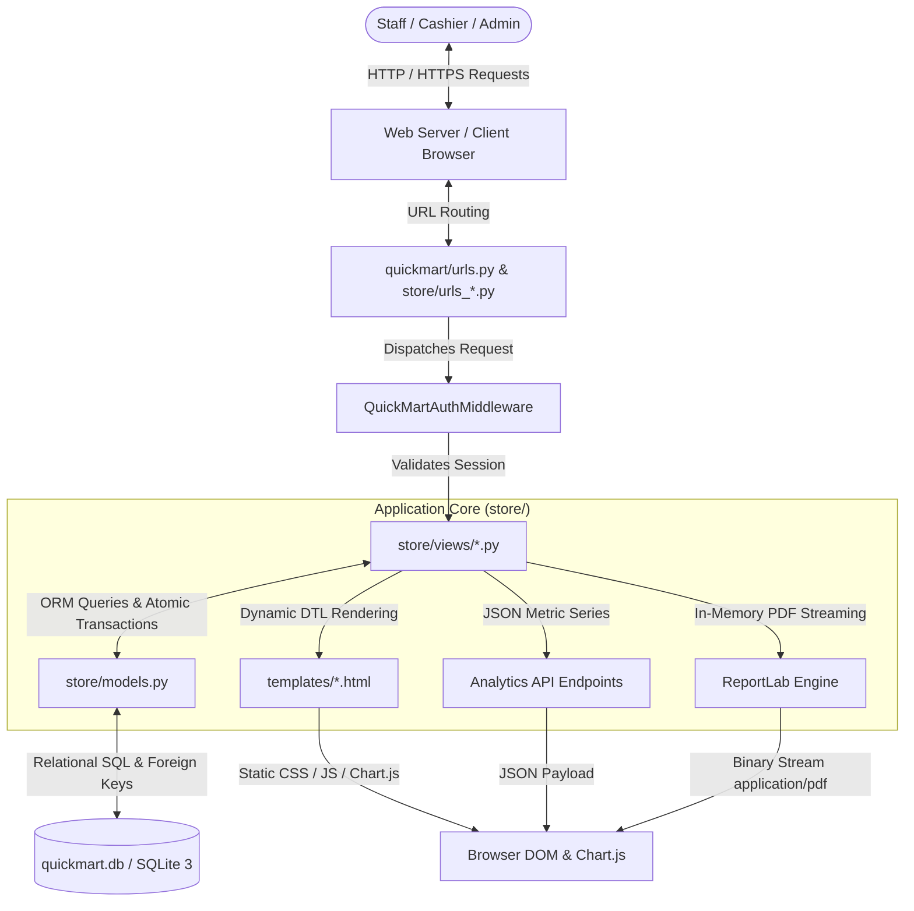

# Quick Mart — System Architecture & Design

This document details the architectural blueprint, data flow pipelines, and technical design patterns powering the **Quick Mart Retail Store Management & Point of Sale (POS) System**.

---

## 1. Architectural Pattern: Django Model-View-Template (MVT)

Quick Mart is designed around Django's Model-View-Template architectural pattern, separating presentation, business logic, and relational persistence.

---

## 2. Core Architectural Subsystems

### A. Point of Sale (POS) Atomic Transaction Pipeline
Retail checkout requires rigorous ACID guarantees to prevent stock over-selling or orphaned receipts:
1. **Cart Payload Reception**: Client-side JavaScript bundles line items into a JSON payload sent via `POST /billing/create` with the `X-CSRFToken` header.
2. **Atomic Context**: The view wraps all operations inside `with transaction.atomic():`.
3. **Validation**: Each product's current shelf stock is compared against requested quantity. If any item is insufficient, the transaction immediately raises an error and halts execution.
4. **Master Bill Creation**: A master invoice is written to the `bills` table with a chronological serial number (`QM-YYYYMM-XXXX`).
5. **Line Item Association**: For each item in the cart, a record is added to `bill_items` storing `product_name` and `price_at_sale`.
6. **Stock Decrement**: Available catalog units are atomically subtracted and persisted.
7. **Commit / Rollback**: If an unhandled exception occurs at any point, the entire transaction rolls back cleanly, leaving database stock and billing history intact.

---

### B. Dynamic PDF Vector Invoicing (ReportLab)
Unlike client-side browser print captures that suffer from unpredictable CSS rendering across browsers, Quick Mart builds server-side vector PDF documents:
- **Buffer**: Creates an in-memory `io.BytesIO()` buffer.
- **Document Template**: Initializes a `SimpleDocTemplate` configured for letter page size.
- **Flowable Elements**: Combines corporate header typography, customer metadata tables, itemized table layouts with zebra striping, and dual GST summary rows.
- **Direct Streaming**: Returns an in-memory `FileResponse` with MIME type `application/pdf` and content-disposition header, enabling instantaneous browser viewing and thermal download.

---

### C. Client-Side Chart.js Integration & Analytics Pipeline
- Store KPIs (daily, weekly, monthly turnover) are pre-aggregated via Django ORM SQL aggregations (`Sum('total_amount')`).
- Chart.js instances on the dashboard poll dedicated JSON endpoints (`/dashboard/api/revenue/<timeframe>`, `/dashboard/api/category/sales`) to asynchronously render responsive bar and doughnut charts without full-page reloads.

---

### D. Session & Dual-Hasher Security Architecture
- **Dual Hasher**: Supports both legacy scrypt hash strings (`scrypt:32768:8:1$<salt>$<hash_hex>`) via `hashlib.scrypt` and modern Django PBKDF2 hashes (`make_password`).
- **Role Isolation**: Middleware validates staff roles (`admin`, `cashier`) and restricts administrative capabilities (such as inventory updates or supplier modifications) to authorized personnel.
