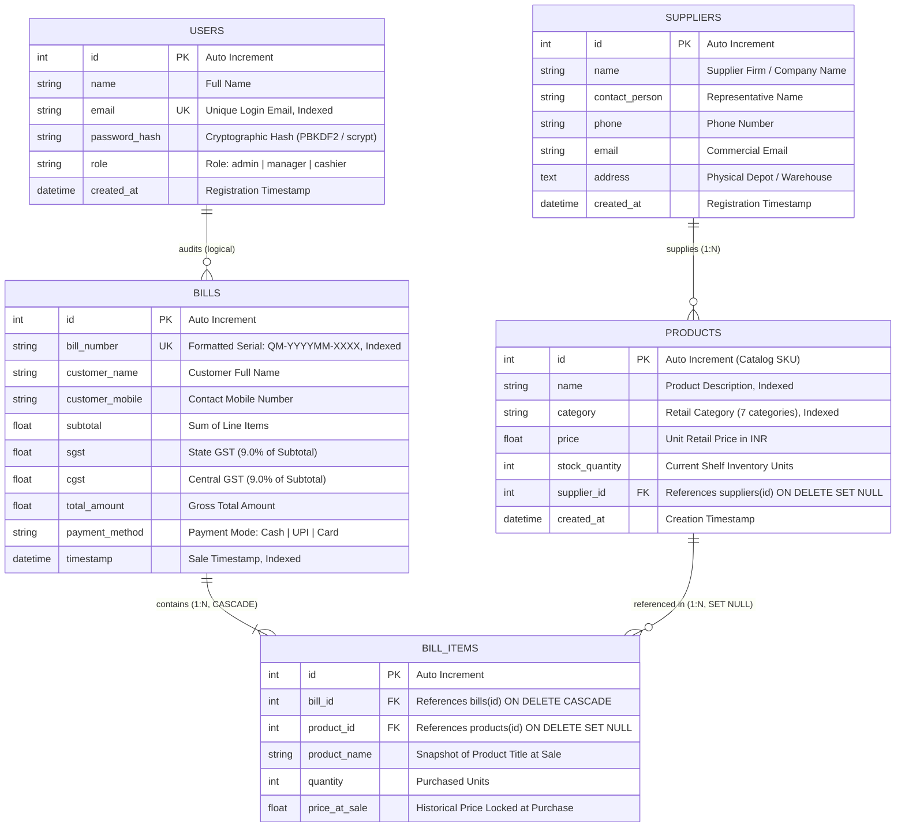

# Quick Mart — Relational Database Schema & Data Dictionary

This document specifies the relational data model, Third Normal Form (3NF) design, foreign key cascading behavior, and data dictionary for the **Quick Mart** database.

---

## 1. Entity-Relationship (ER) Diagram



---

## 2. Table Specifications & Data Dictionary

### Table 1: `users`
Stores user credentials, staff accounts, and operational roles.
| Column | Type | Constraints | Description |
| :--- | :--- | :--- | :--- |
| `id` | INTEGER | PRIMARY KEY, AUTOINCREMENT | Internal user identifier |
| `name` | VARCHAR(100) | NOT NULL | User full legal name |
| `email` | VARCHAR(120) | NOT NULL, UNIQUE, INDEX | Login email address |
| `password_hash` | VARCHAR(255) | NOT NULL | Cryptographic scrypt or PBKDF2 hash |
| `role` | VARCHAR(50) | NOT NULL, DEFAULT 'cashier' | User authorization role (`admin`, `cashier`) |
| `created_at` | DATETIME | DEFAULT CURRENT_TIMESTAMP | Account creation timestamp |

### Table 2: `suppliers`
Tracks authorized wholesale suppliers and distributor contacts.
| Column | Type | Constraints | Description |
| :--- | :--- | :--- | :--- |
| `id` | INTEGER | PRIMARY KEY, AUTOINCREMENT | Vendor record identifier |
| `name` | VARCHAR(150) | NOT NULL | Supplier firm / business name |
| `contact_person` | VARCHAR(100) | NULLABLE | Primary representative contact |
| `phone` | VARCHAR(25) | NULLABLE | Direct telephone number |
| `email` | VARCHAR(120) | NULLABLE | Commercial email address |
| `address` | TEXT | NULLABLE | Warehouse or depot address |
| `created_at` | DATETIME | DEFAULT CURRENT_TIMESTAMP | Registration timestamp |

### Table 3: `products`
Maintains retail catalog inventory across 7 departments.
| Column | Type | Constraints | Description |
| :--- | :--- | :--- | :--- |
| `id` | INTEGER | PRIMARY KEY, AUTOINCREMENT | Stock Keeping Unit (SKU) |
| `name` | VARCHAR(150) | NOT NULL, INDEX | Commercial product description |
| `category` | VARCHAR(50) | NOT NULL, INDEX | Department (Vegetables, Fruits, Grocery, etc.) |
| `price` | FLOAT | NOT NULL | Unit selling price in INR (₹) |
| `stock_quantity` | INTEGER | NOT NULL, DEFAULT 0 | Available stock units |
| `supplier_id` | INTEGER | FK (`suppliers.id`), NULLABLE | Assigned supplier (`ON DELETE SET NULL`) |
| `created_at` | DATETIME | DEFAULT CURRENT_TIMESTAMP | Product entry timestamp |

### Table 4: `bills`
Records master sales transactions generated at the checkout terminal.
| Column | Type | Constraints | Description |
| :--- | :--- | :--- | :--- |
| `id` | INTEGER | PRIMARY KEY, AUTOINCREMENT | Internal invoice identifier |
| `bill_number` | VARCHAR(50) | NOT NULL, UNIQUE, INDEX | Sequential formatted serial (`QM-YYYYMM-XXXX`) |
| `customer_name` | VARCHAR(100) | NOT NULL | Customer name |
| `customer_mobile` | VARCHAR(25) | NOT NULL | Contact telephone number |
| `subtotal` | FLOAT | NOT NULL | Net sum of item totals |
| `sgst` | FLOAT | NOT NULL | State GST component (9%) |
| `cgst` | FLOAT | NOT NULL | Central GST component (9%) |
| `total_amount` | FLOAT | NOT NULL | Final invoice total |
| `payment_method` | VARCHAR(30) | NOT NULL, DEFAULT 'Cash' | Tender type (`Cash`, `UPI`, `Card`) |
| `timestamp` | DATETIME | DEFAULT CURRENT_TIMESTAMP, INDEX | Checkout completion timestamp |

### Table 5: `bill_items`
Maintains individual line items associated with each master invoice.
| Column | Type | Constraints | Description |
| :--- | :--- | :--- | :--- |
| `id` | INTEGER | PRIMARY KEY, AUTOINCREMENT | Line item identifier |
| `bill_id` | INTEGER | FK (`bills.id`), NOT NULL | Parent bill (`ON DELETE CASCADE`) |
| `product_id` | INTEGER | FK (`products.id`), NULLABLE | Catalog product (`ON DELETE SET NULL`) |
| `product_name` | VARCHAR(150) | NOT NULL | Product name snapshot at checkout |
| `quantity` | INTEGER | NOT NULL | Units purchased |
| `price_at_sale` | FLOAT | NOT NULL | Historical unit price at sale |

---

## 3. Key Relational Design Highlights

1. **Historical Immutability (`price_at_sale`)**:
   Product prices fluctuate in retail environments. Storing `price_at_sale` in `bill_items` ensures that future price changes in the `products` table never alter past financial records or printed receipts.
2. **Cascading Integrity**:
   - `ON DELETE CASCADE` on `bill_items.bill_id`: If a bill is voided/removed, its line items are automatically cleaned up to prevent orphaned rows.
   - `ON DELETE SET NULL` on `products.supplier_id` and `bill_items.product_id`: If a supplier or product is retired from the catalog, sales history remains preserved.
3. **Database Reconstitution**:
   A complete schema definition and seed dataset is maintained at [`database/quickmart_schema_and_seed.sql`](../database/quickmart_schema_and_seed.sql) and can be executed via:
   ```bash
   python database/init_db.py
   ```
