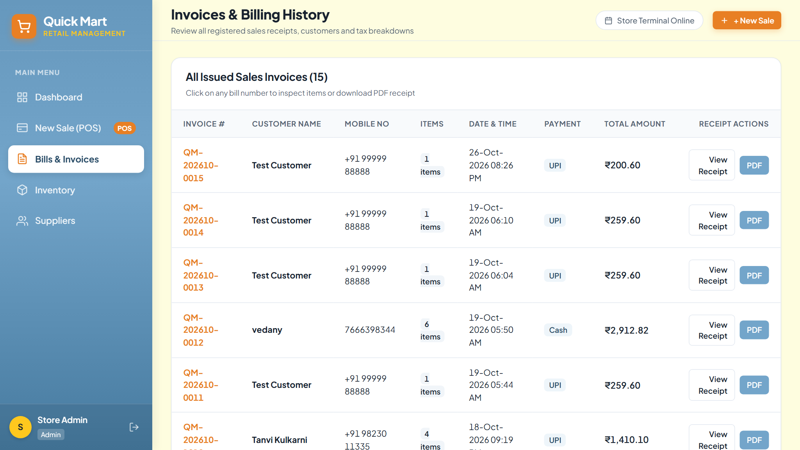

# Quick Mart — Application Screenshot Walkthrough

This document showcases actual user interface screenshots captured directly from the running **Quick Mart Retail Store Management & POS System**.

---

### 1. Staff Authentication & Login

*Modern split-panel login interface featuring branded typography, email and password validation, role hints, and security notices.*

---

### 2. Executive Management Dashboard

*Executive dashboard featuring real-time financial KPI cards (Today's, Weekly, Monthly revenue, total bills), quick action buttons, critical stock alerts, and recent transactions.*

---

### 3. Interactive Point of Sale (POS) Billing Terminal

*High-velocity dual-panel checkout terminal featuring live catalog search, category filtering chips, instant reactive cart calculations, automatic SGST (9%) and CGST (9%) tax splitting, and payment method selectors.*

---

### 4. Reactive Inventory & Stock Health Monitoring

*Multi-category product catalog table with three-tier visual stock health badges (Critical $<10$, Low $10–30$, Healthy $>30$), supplier associations, search, filter, and CRUD actions.*

---

### 5. Wholesale Supplier Directory

*Wholesale supplier and vendor directory displaying company names, account representatives, contact numbers, email addresses, physical warehouse locations, and linked product counts.*

---

### 6. Interactive Business Intelligence & Sales Analytics

*Visual analytics section powered by Chart.js displaying multi-horizon gross turnover trends (Daily 14-day, Weekly 8-week, Monthly 12-month) alongside category-wise sales revenue distributions.*

---

### 7. Formatted Tax Receipt & Thermal Print View

*Thermal-optimized customer tax invoice displaying sequential bill serial numbers (`QM-YYYYMM-XXXX`), customer metadata, itemized line items, GST calculations, and one-click PDF download.*

---

### 8. Transactional Billing History

*Chronological transaction ledger tracking all finalized customer receipts, payment methods, transaction timestamps, and direct receipt/PDF viewing options.*
